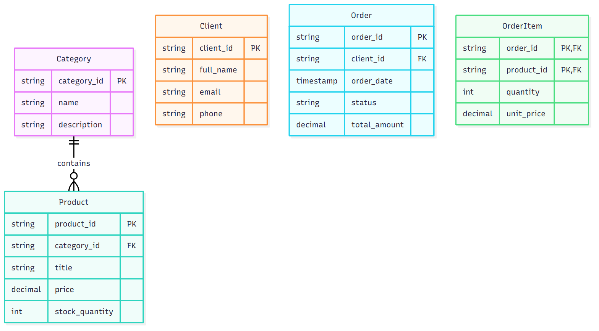

# Gadget Zone — ER-модель

Цей репозиторій містить логічну модель даних інтернет-магазину ґаджетів Gadget Zone. Вона описує каталог товарів і категорій, клієнтів, замовлення та позиції замовлень із ціною товару на момент покупки.

Текстова специфікація наведена у [spec.md](spec.md), а рішення щодо зв'язку замовлень і товарів пояснено в [ADR 001](docs/adr/001-order-item-association.md). ER-діаграма згенерована з декларативного джерела Mermaid [er-model.mmd](docs/er-model.mmd).

